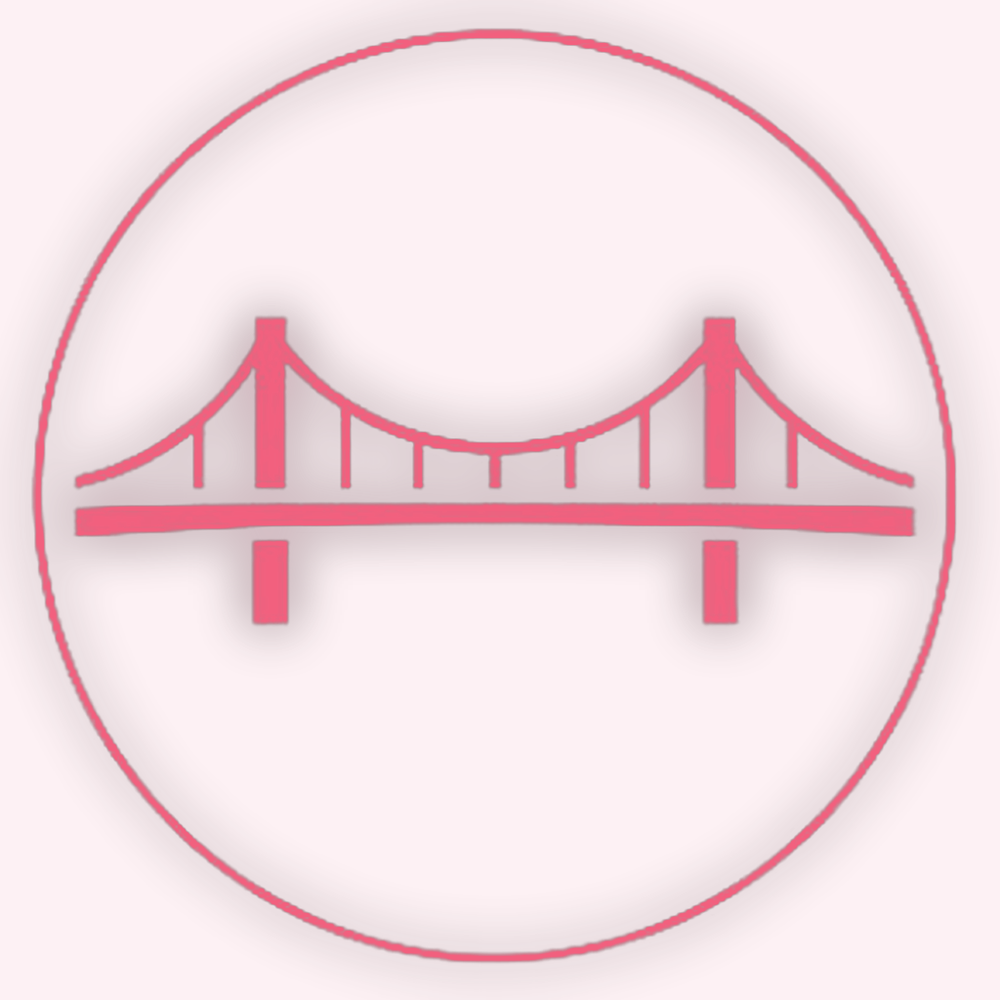

# The Bridge Peer — Keva Sutton

Website designer and graphic designer for small businesses.

## What I do

- One-page websites that are clean, mobile friendly, and easy for customers to use
- Logo design
- Flyers and business cards
- Design examples include full website mockups for cleaning services, salons, auto care, food businesses, and lawn care

## In this repository

- `index.html` — the master copy of The Bridge Peer website code
- `bridge-peer-logo-pink.png` — the pink Bridge Peer logo
- `design-examples/` — design examples, including:
  - `bridge-peer-logo-pink.png` — pink Bridge Peer logo
  - `logos-ive-designed-sutton.png` — grid of logos Keva has designed
  - `marketplace-cover-photo-sutton.png` — Sutton designer flyer with pricing
  - `example-website-mockup.png` — Angela's Sparkling Spotless Spaces website mockup
  - `example-kit-brightnest-cleaning.png` — BrightNest Cleaning example page kit
  - `example-kit-elmwood-cuts.png` — Elmwood Cuts example page kit
  - `example-kit-gilded-rose.png` — Gilded Rose example page kit
  - `example-kit-lawn-care.png` — Fresh Cut Lawn Co example page kit
  - `example-kit-niagara-auto-care.png` — Niagara Auto Care example page kit
  - `example-kit-rolling-skillet.png` — The Rolling Skillet example page kit
  - `color-sheet-expanded.png` — brand color sheet
  - `font-sheet-expanded.png` — brand font sheet

## Service areas

Buffalo, Rochester, Geneva, Watertown, and Syracuse, NY. Remote friendly everywhere.

## Contact

- Email: keva.crpa@gmail.com
- Phone: (315) 278-0682
